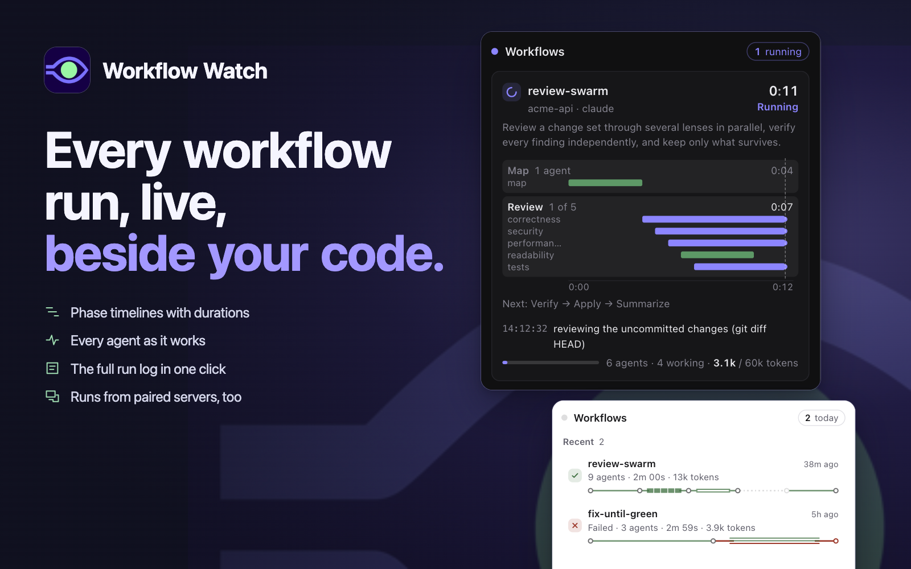
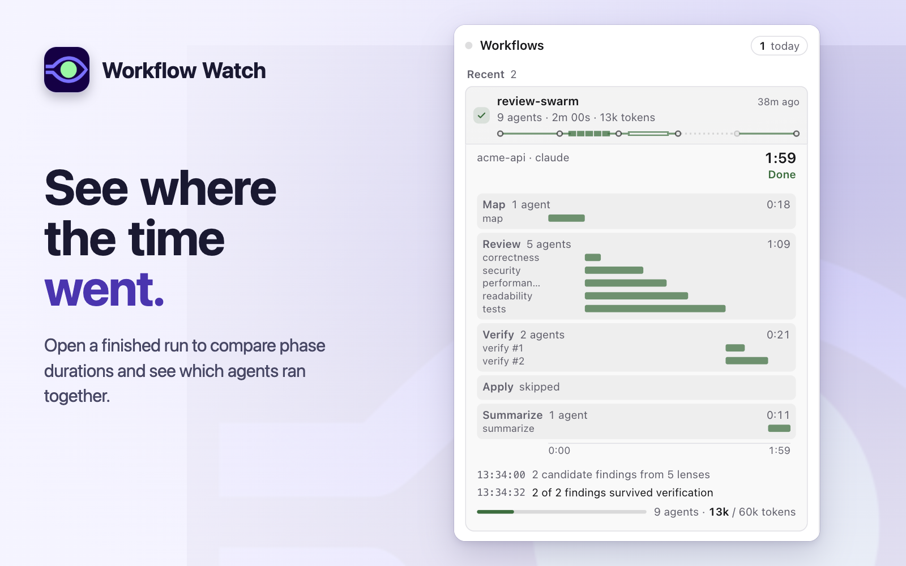
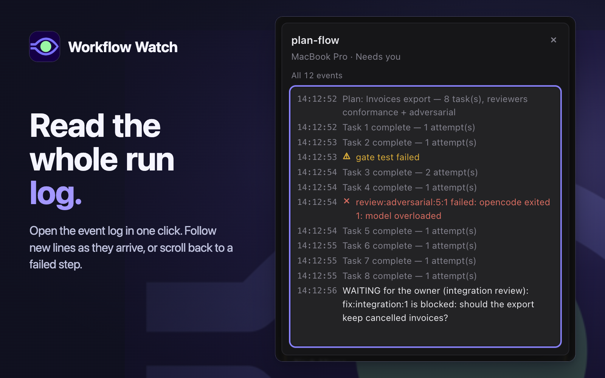
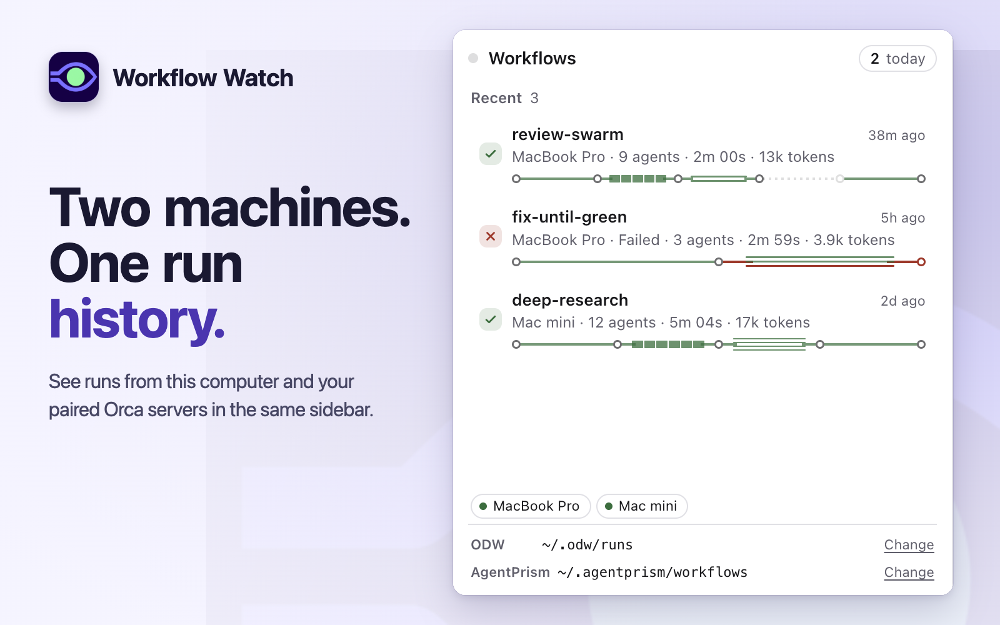

# Workflow Watch for Orca



**Every workflow run, live, beside your code.**

Your agents run long workflows. You shouldn't have to tail a folder of JSON to know how they're going. Workflow Watch puts every [Open Dynamic Workflows](https://github.com/xz1220/open-dynamic-workflows) (ODW) and [AgentPrism Workflows](https://github.com/agentprism/agentprism-workflows) run in [Orca](https://github.com/stablyai/orca)'s right sidebar, from this computer and from your paired Orca servers. See each phase and agent as it works, how long each one took, the whole run log, and the moment a run finishes or needs you. It only reads: it never writes into a run, and neither engine's server has to run.

A community plugin, not made or endorsed by Orca.

## Watch agents work in parallel


Each live run gets a card with a ticking clock and a timeline. Every phase is a band and every agent a bar that grows while it works, so a parallel review reads as parallel. The phases still to come are listed under it, the latest log lines scroll in below, and a meter counts the tokens spent (against the budget, when the run has one). Click an agent to see what it was asked, what it answered, its stderr, time and tokens.

When a run stops at a checkpoint, its card turns amber and shows how to answer, with a Copy button.

## See where the time went



Open a finished run and every phase shows how long it took. The agents' bars show which ones ran together and which one held the phase up. In the history list, each run is one line of stations and tracks, and a hover gives each phase's time.

## Read the whole run log



"Show all N events" opens the run's whole log over the panel. It keeps following new lines while you stay at the bottom, and holds still when you scroll back to a failed step. Warnings and errors carry a mark as well as a colour.

## Two machines. One run history.



Runs from this computer and from your paired Orca servers share one list, each named by the computer it ran on. Each server runs the plugin too; [Install](#install) says how. A desktop notification fires when a run finishes, fails, stops answering or waits for you, even with the panel closed.

## Install

Needs Orca 1.4.248 or newer. Install Workflow Watch from the publisher’s `ChristianOrrala/agents` catalog on the computer whose runs you want to watch.

```sh
orca plugin catalog add ChristianOrrala/agents
orca plugin install christianorrala.workflow-watch-orca
orca plugin update christianorrala.workflow-watch-orca   # later
```

If Orca answers `approval_required`, run the command it prints with `--approve <fingerprint>` before continuing.

**With paired Orca servers:** the plugin must also run on each server, loaded there as a development folder (key `local.workflow-watch-orca`), because the worker asks a paired server through `orca plugin dev request`, which reaches only development plugins (Orca refuses it for installed ones). On each server (or from your computer, with `--environment <server>` and the server's absolute path):

```sh
git clone https://github.com/ChristianOrrala/orca-workflow-watch.git
orca plugin dev load ./orca-workflow-watch --json                          # prints the approval
orca plugin dev load ./orca-workflow-watch --approve <fingerprint> --json
# later: git pull, then orca plugin dev reload ./orca-workflow-watch
```

The panel then shows a chip for each paired server under the runs; one without the plugin reads "not set up" in the header. Your own computer can use either a catalog install or a development folder. Every computer runs the same version: update them together.

## How it works

### Feature reference

- **A card per live run:** a ticking clock and the run as a timeline. Time runs left to right: each phase is a band, each agent a bar in a lane that grows while it works, a failed agent a red striped bar. A phase that repeats a few roles (implement, review, fix) gets a lane per role, so a loop reads as a loop; a big crowd shares packed lanes. The time a checkpoint waited is an amber band across the phases, and the phases still to come read "Next: …". A run that finishes gets a short sheen (a red wash if it failed) before it settles into the history. Animations pause while Orca's window is hidden.
- **Phase times:** each phase in the open card shows how long it took (`1:36:42`, or `4:05` under an hour); the current one ticks. A phase of commands only takes its span from its commands, so ODW's Preflight, marked after its commands ran, shows their real time. History rows show each phase's time on hover over the metro line.
- **The whole log on demand:** the card shows the run's last lines; "Show all N events" opens every line the worker keeps (the newest 500, with a note of how many older ones were dropped) in a dialog over the panel, newest at the bottom. It updates while the run runs: left at the bottom it follows new lines, scrolled up it stays put. Close it with its button, Esc or a click outside it. It works for runs on paired servers too.
- **Checkpoints stand out:** a run waiting at `checkpoint()` turns amber and shows how to answer it, with a Copy button (the worker copies on the computer you're at): ODW's `odw approve <run>` command, or for AgentPrism the `resume` call to give its workflow tool from an agent working in that project.
- **Click any agent:** it opens a sheet with what it was asked, what it answered (or its latest output while it runs), its stderr, adapter, time and tokens.
- **History rows:** finished runs, each drawn as a metro line: its phases as stations, its agents as tracks. Click a row to open the full card. Back-to-back runs of one workflow that all ended well fold into one row (`review-swarm ×7`) with a bar per run, and it opens; a failure or a question keeps its own row, and a question a newer run took over reads "Asked".
- **Paired servers:** with paired servers, each row and card names the computer it ran on, and a chip for each computer sits under the list. A server out of reach reads "unreachable" in the header, and one without the plugin reads "not set up".
- **Stale data shows:** with a live run on screen and no word from the worker for 30 s, the clocks dim and a "no updates" chip appears (the worker posts at least every 10 s).
- **Status bar and notifications:** a `Workflows` item reports running and waiting runs, and a desktop notification fires when a run finishes, fails, stops answering or waits for you. The status bar item keeps the worker running, so the notifications still arrive with the panel closed.

It only reads, and never writes into a run. Both engines keep each run as plain files, and the worker follows them with a file watcher plus a slow poll, so neither engine's server has to run.

### Engines

Each engine is a run source (`src/sources/`, the `RunSource` interface in `types.ts`): it lists its runs, reads each one into the same view (phases, agents, log, tokens, state) and reads one agent's detail. The panel only sees those views. When runs from more than one engine are on screen, each names its engine.

- **ODW** (`sources/odw.ts`): `<runsRoot>/<workflow>/<runId>/` with `status.json`, `meta.json`, `events.jsonl` and `agents/`. It needs no `odw serve`.
- **AgentPrism** (`sources/agentprism.ts`): `<root>/projects/<project>/runs/<runId>.json` (the run's record), `.events.jsonl`, `.script.js` (its `meta` gives the description and declared phases) and `.lock` (the pid of the process running it). Its events are translated into the stream the ODW reader already folds. A paused run reads Paused with its reason (a usage limit, a sign-in, a request) and the `resume` call to give AgentPrism's workflow tool. So does a run whose process died: AgentPrism saves it as an interrupted pause, and a resume picks it up where it stopped, so it never reads Lost. Calls a resume replays from AgentPrism's journal are not counted again. The worker never starts an AgentPrism manager: one that journals would rewrite the runs it reads.

Adding an engine is one more `RunSource` in the worker's list.

### Settings

| Setting | Default | |
|---|---|---|
| Runs folder | `~/.odw/runs` | ODW's `runsRoot`. Also changeable from the panel footer. |
| AgentPrism runs folder | `~/.agentprism/workflows` | AgentPrism's `AGENTPRISM_PERSISTENCE_ROOT`. Also changeable from the panel footer. |
| Notify me | on | Finished, failed, lost and waiting runs. |
| Finished runs to show | 12 | Live runs always show. |

### Access it asks for

`trusted-worker` (its worker is Node and reads the runs folders), `settings:own`, `notifications:show`. It opens no network connection itself and no terminal. It does run local programs:

- **The Orca CLI**, to ask each paired Orca server for its runs (a snapshot every few seconds while one is live) and for an agent's detail when you open one. Set "Paired servers to watch" to `off` and it asks none.
- **The clipboard program** (`pbcopy`, `clip`, `wl-copy`, `xclip` or `xsel`) when you press Copy, with the text on its input.
- **`ps`**, on macOS, to check that a run's recorded process is still the same one (ODW's own check).

It reads run files as regular files only (never through a symlink), with size limits, and the commands it offers to copy are built only from run ids the engine itself would issue.

## License

MIT, see [LICENSE](LICENSE). Workflow Watch for Orca is an independent project: it is not made, maintained or endorsed by Orca or Stably, nor by the ODW or AgentPrism projects whose runs it reads.

## Develop

```sh
orca plugin test . --json          # node:test, with a real ODW dry run and real AgentPrism runs as fixtures
orca plugin validate . --json
orca plugin dev load . --json      # prints the approval; re-run with --approve <fingerprint>

# Fake runs in ODW's file format, without spending a model call:
node scripts/simulate-run.mjs --root ~/.odw/runs-demo --loop

# The panel in a browser, driven by the real worker on a stand-in Orca host:
node --import ./dev/register.mjs dev/preview.mjs --root ~/.odw/runs-demo [--agentprism test/fixtures/agentprism]
# then http://127.0.0.1:4517/  (?theme=light, ?w=320)
```

Type-check with `tsc -p .` and `@types/node` available; Orca's typings land in `.orca/types/` (`orca plugin types .`).
