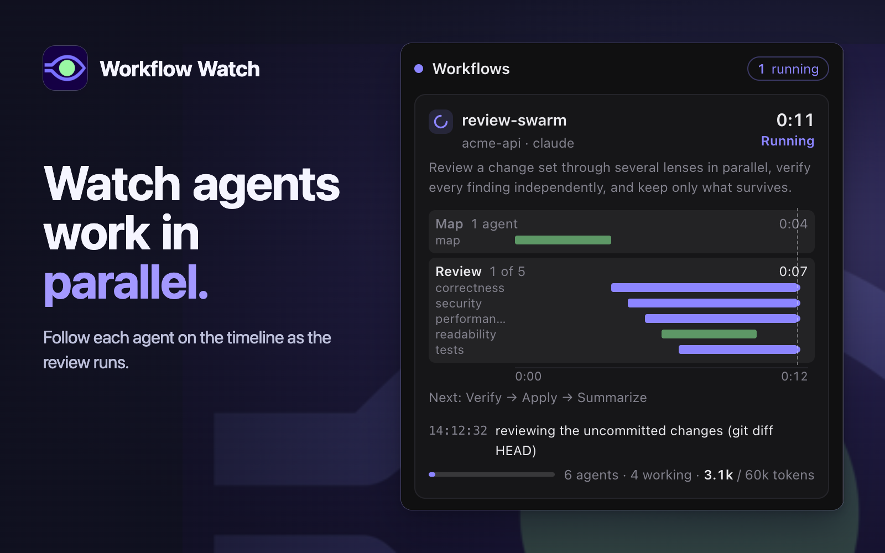

# Workflow Watch for Orca


**Every workflow run, live, beside your code.**

Your agents run long workflows. You shouldn't have to tail a folder of JSON to know how they're going. Workflow Watch puts every [Open Dynamic Workflows](https://github.com/xz1220/open-dynamic-workflows) (ODW) and [AgentPrism Workflows](https://github.com/agentprism/agentprism-workflows) run in [Orca](https://github.com/stablyai/orca)'s right sidebar, from this computer and from your paired Orca servers. See each phase and agent as it works, how long each one took, the whole run log, and the moment a run finishes or needs you. It only reads: it never writes into a run, and neither engine's server has to run.

A community plugin, not made or endorsed by Orca.

## Watch agents work in parallel



Each live run gets a card with a ticking clock and a timeline. Every phase is a band and every agent a bar that grows while it works, so a parallel review reads as parallel. The phases still to come are listed under it, the latest log lines scroll in below, and a meter counts the tokens spent (against the budget, when the run has one). Click an agent to see what it was asked, what it answered, its stderr, time and tokens.

When a run stops at a checkpoint, its card turns amber and shows how to answer, with a Copy button.

## See where the time went


Open a finished run and every phase shows how long it took. The agents' bars show which ones ran together and which one held the phase up. In the history list, each run is one line of stations and tracks, and a hover gives each phase's time.

## Read the whole run log


"Show all N events" opens the run's whole log over the panel. It keeps following new lines while you stay at the bottom, and holds still when you scroll back to a failed step. Warnings and errors carry a mark as well as a colour.

## Two machines. One run history.


Runs from this computer and from your paired Orca servers share one list, each named by the computer it ran on. Each server runs the plugin too, installed the same way as here. A desktop notification fires when a run finishes, fails, stops answering or waits for you, even with the panel closed.

## Install

Needs Orca 1.4.248 or newer. Install Workflow Watch from the publisher’s `ChristianOrrala/agents` catalog on the computer whose runs you want to watch.

```sh
orca plugin catalog add ChristianOrrala/agents
orca plugin install christianorrala.workflow-watch-orca
orca plugin update christianorrala.workflow-watch-orca   # later
```

If Orca answers `approval_required`, run the command it prints with `--approve <fingerprint>` before continuing.

**With paired Orca servers:** install the plugin on each server too, from the same catalog. No development folder is needed. From your own computer, `--environment` does it on the server:

```sh
orca plugin catalog add ChristianOrrala/agents --environment <server>
orca plugin install christianorrala.workflow-watch-orca --environment <server>
```

The panel then shows a chip for each paired server under the runs. One without the plugin, or with it turned off, reads "not set up" in the header. One whose plugin has stopped sending runs (its worker stopped, or it runs a version older than 0.4.0) reads "not updating". Every computer runs the same version, so update them together. A copy loaded from a development folder works too, and can also show its agents' prompts and full logs (see [Paired servers](#paired-servers)).

## How it works

### Feature reference

- **A card per live run:** a ticking clock and the run as a timeline. Time runs left to right: each phase is a band, each agent a bar in a lane that grows while it works, a failed agent a red striped bar. A phase that repeats a few roles (implement, review, fix) gets a lane per role, so a loop reads as a loop; a big crowd shares packed lanes. The time a checkpoint waited is an amber band across the phases, and the phases still to come read "Next: …". A run that finishes gets a short sheen (a red wash if it failed) before it settles into the history. Animations pause while Orca's window is hidden.
- **Phase times:** each phase in the open card shows how long it took (`1:36:42`, or `4:05` under an hour); the current one ticks. A phase of commands only takes its span from its commands, so ODW's Preflight, marked after its commands ran, shows their real time. History rows show each phase's time on hover over the metro line.
- **The whole log on demand:** the card shows the run's last lines; "Show all N events" opens every line the worker keeps (the newest 500, with a note of how many older ones were dropped) in a dialog over the panel, newest at the bottom. It updates while the run runs: left at the bottom it follows new lines, scrolled up it stays put. Close it with its button, Esc or a click outside it. It works for runs on paired servers too.
- **Checkpoints stand out:** a run waiting at `checkpoint()` turns amber and shows how to answer it, with a Copy button (the worker copies on the computer you're at): ODW's `odw approve <run>` command, or for AgentPrism the `resume` call to give its workflow tool from an agent working in that project.
- **Click any agent:** it opens a sheet with what it was asked, what it answered (or its latest output while it runs), its stderr, adapter, time and tokens.
- **History rows:** finished runs, each drawn as a metro line: its phases as stations, its agents as tracks (a few as stacked tracks, a crowd as a block of cells in bands, a failed one striped red). Phases the run never reached are dotted, and where a failed run stopped is a red station. Click a row to open the full card. Back-to-back runs of one workflow that all ended well fold into one row (`review-swarm ×7`) with a bar per run, and it opens; a failure or a question keeps its own row, and a question a newer run took over reads "Asked".
- **Paired servers:** with paired servers, each row and card names the computer it ran on, and a chip for each computer sits under the list. A server out of reach reads "unreachable" in the header, one without the plugin reads "not set up", and one whose runs stopped coming for 30 s reads "not updating" (its runs leave the list until they come back). Everything in a run's card comes across: its phases and their times, its agents with their state, times and tokens, its checkpoints, and its last log lines. "Show all" on a server's newest run (the one started last, live or ended) shows its last 50 events. What an agent was asked and answered, and the rest of a run's log, stay on the server; the panel says so where they would show.
- **Stale data shows:** with a live run on screen and no word from the worker for 30 s, the clocks dim and a "no updates" chip appears (the worker posts at least every 10 s).
- **Status bar and notifications:** `Workflows` shows the running count across all watched workspaces and paired servers. When nothing is running, it shows waiting or paused runs, or the latest result while it is news: `Workflows · Passed` in green for 15 minutes after the run ended, `Workflows · Last failed` in red until a newer run of any workflow passes or 24 hours have gone by. Then it goes calm (`Workflows`, neutral), and the tooltip still gives the last result and how long ago (`Last passed: review-swarm (main) · 2h ago`). Both windows are settings. The bar changes on its own when a window runs out. Hover for active workflow names, statuses, branches when recorded, and paired-server names. Click to open the Workflows panel. No GitHub connection is needed. The status bar keeps the worker running, so finish, failure, lost-run and checkpoint notifications still arrive with the panel closed.

It only reads, and never writes into a run. Both engines keep each run as plain files, and the worker follows them with a file watcher plus a slow poll, so neither engine's server has to run.

### Engines

Each engine is a run source (`src/sources/`, the `RunSource` interface in `types.ts`): it lists its runs, reads each one into the same view (phases, agents, log, tokens, state) and reads one agent's detail. The panel only sees those views. When runs from more than one engine are on screen, each names its engine.

- **ODW** (`sources/odw.ts`): `<runsRoot>/<workflow>/<runId>/` with `status.json`, `meta.json`, `events.jsonl` and `agents/`. It needs no `odw serve`.
- **AgentPrism** (`sources/agentprism.ts`): `<root>/projects/<project>/runs/<runId>.json` (the run's record), `.events.jsonl`, `.script.js` (its `meta` gives the description and declared phases) and `.lock` (the pid of the process running it). Its events are translated into the stream the ODW reader already folds. A paused run reads Paused with its reason (a usage limit, a sign-in, a request) and the `resume` call to give AgentPrism's workflow tool. So does a run whose process died: AgentPrism saves it as an interrupted pause, and a resume picks it up where it stopped, so it never reads Lost. Calls a resume replays from AgentPrism's journal are not counted again. The worker never starts an AgentPrism manager: one that journals would rewrite the runs it reads.

Adding an engine is one more `RunSource` in the worker's list.

### Paired servers

A plugin worker runs on the computer whose Orca loaded it, and the plugin API does not reach a paired server. The Orca CLI does, with `--environment`. Orca's `plugin dev request` reaches development folders only, so the runs travel through the plugin's log, which `orca plugin logs` reads for an installed copy too (`src/beacon.ts`):

- **Each computer publishes its own runs** as log lines that start with `WWATCH1`. Each run is one record, named by a hash of its contents, in short keys with times relative to its start. A record longer than a line is cut into numbered pieces, and every line stays under 4,096 characters (Orca cuts a line at 8,192 without saying so). A manifest line lists the records that make up the computer's runs now. Only what changed is written, at most every 2 s: a live run's update costs its own record and a manifest. When nothing changes, a short heartbeat goes out every 10 s.
- **Each desktop reads them**: it lists the paired servers (`orca environment list`), finds the plugin's key on each one (`orca plugin list --environment <id>`: any key with the id `workflow-watch-orca`, from a catalog or a folder), and reads its log (`orca plugin logs <key> --environment <id>`) every 3 s while that server has a live run, else every 10 s. It joins only the records it holds whole, and takes the newest manifest. A server whose beacon has not moved for 3 intervals (30 s) is stale.
- **The 200-line budget:** Orca keeps a plugin's newest 200 log lines and answers all of them on every read. The writer writes every record and the manifest again before 90 of its own lines have gone by, and one manifest names at most 54 run pieces (the oldest finished runs are left out first; live runs always stay) and 6 tail pieces. That is at most 151 lines, so a reader always finds every record of the newest manifest, with 49 lines to spare for Orca's own. It also keeps the plugin's log readable: an idle computer writes one short line every 10 s, and the worker's own messages are written once per change, not every minute.
- **The newest run's tail:** the run started last, live or ended, also goes out with its last 50 log events (each cut at 400 characters, as in its record) as a record of its own line kind, in at most 6 pieces, which the manifest names. It is written again when that run changes or its log grows, at the same pace as the rest. "Show all" on that run shows those 50 events and says how many more stay on the server.
- **Too big to publish:** an agent's prompt and answer and any other run's full log (up to 500 lines) would crowd the 200 lines out, and no CLI call can carry a request to an installed plugin. Clicking an agent of a run on a server shows its state, times and tokens and says that the rest is on that server; "Show all" on any run but the newest shows the lines the run carries and says the same. When the server's copy is a development folder, the desktop still asks it for them with `orca plugin dev request`, as before.

### Settings

| Setting | Default | |
|---|---|---|
| Runs folder | `~/.odw/runs` | ODW's `runsRoot`. Also changeable from the panel footer. |
| AgentPrism runs folder | `~/.agentprism/workflows` | AgentPrism's `AGENTPRISM_PERSISTENCE_ROOT`. Also changeable from the panel footer. |
| Notify me | on | Finished, failed, lost and waiting runs. |
| Finished runs to show | 12 | Live runs always show. |
| Passed runs stay green for (minutes) | 15 | How long the status bar shows a pass in green after its run ended. 0 never does; at most 10080 (a week). |
| Failed runs stay red for (minutes) | 1440 | How long the status bar shows a failure in red after its run ended, unless a newer run passes first. 0 never does; at most 10080. |

### Access it asks for

`trusted-worker` (its worker is Node and reads the runs folders), `settings:own`, `notifications:show`. It opens no network connection itself and no terminal. It does run local programs:

- **The Orca CLI**, to open the Workflows panel from the status bar, to read each paired Orca server's plugin list and this plugin's log there (every few seconds while a run is live), and, from a server's development folder, an agent's detail when you open one. Set "Paired servers to watch" to `off` and it reads none. It also writes this computer's runs into its own plugin log, for the desktops paired to it ([Paired servers](#paired-servers)).
- **The clipboard program** (`pbcopy`, `clip`, `wl-copy`, `xclip` or `xsel`) when you press Copy, with the text on its input.
- **`ps`**, on macOS, to check that a run's recorded process is still the same one (ODW's own check).

It reads run files as regular files only (never through a symlink), with size limits, and the commands it offers to copy are built only from run ids the engine itself would issue.

## License

MIT, see [LICENSE](LICENSE). Workflow Watch for Orca is an independent project: it is not made, maintained or endorsed by Orca or Stably, nor by the ODW or AgentPrism projects whose runs it reads.

## Develop

```sh
orca plugin test . --json          # node:test, with a real ODW dry run and real AgentPrism runs as fixtures
orca plugin validate . --json
orca plugin dev load . --json      # prints the approval; re-run with --approve <fingerprint>

# Fake runs in ODW's file format, without spending a model call:
node scripts/simulate-run.mjs --root ~/.odw/runs-demo --loop

# The panel in a browser, driven by the real worker on a stand-in Orca host:
node --import ./dev/register.mjs dev/preview.mjs --root ~/.odw/runs-demo [--agentprism test/fixtures/agentprism]
# then http://127.0.0.1:4517/  (?theme=light, ?w=320)
```

Type-check with `tsc -p .` and `@types/node` available; Orca's typings land in `.orca/types/` (`orca plugin types .`). To try the status bar, approve the development folder, open any Orca workspace, and run an ODW or AgentPrism workflow from a watched runs folder. Look for **Workflows** in Orca's status bar. `orca plugin shot . --status-bar` captures the bar on the desktop.
